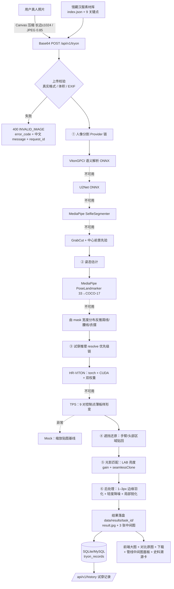

# 衣溯AI · 虚拟试穿模块 —— 项目书正文（可直接粘贴章节）

> 本文按「设计说明 → 方案对比 → 实测数据 → 局限性 → 部署」组织，内容全部对应仓库中真实存在的代码与实测结果，
> 未包含任何尚未实现的功能承诺。

---

## 1. 模块定位

在汉服文化传承类应用中，「虚拟试穿」是连接**馆藏服饰数字化**与**用户沉浸体验**的核心环节。
本模块解决三个问题：

1. **能不能跑**：参赛/演示环境多为无独立显卡的普通笔记本，任何依赖 GPU 或大体积权重的方案都会导致「现场演示打不开」。
   → 采用**可插拔推理 + 零权重几何兜底**架构，保证任何机器都能端到端出图。
2. **跑得好不好看**：仿射变换无法表达「衣服被手臂遮挡」与「腰带处收腰」。
   → 采用**薄板样条（TPS）**以服饰 9 个语义关键点对齐人体肩线/腰线/衣摆，并叠加遮挡还原与光影匹配。
3. **跑完有没有文化增量**：试穿不只是贴图。
   → 每件服饰绑定**史料溯源卡片**（形制描述 + 文献/图源），试穿结果与溯源信息同屏呈现，呼应「衣溯」主题。

---

## 2. 系统流程

### 2.1 端到端流程图



### 2.2 若不支持 Mermaid 渲染，用此文字版

```
照片 → 前端压缩 → 上传校验 → 人像分割(4级降级) → 姿态估计(2级降级)
     → 试穿推理(HR-VITON → TPS → Mock) → 遮挡还原 → 光影匹配 → 边缘羽化
     → 结果落盘 + 记录入库 → 前端展示(结果图 / 中间图 / 溯源卡 / 下载)
```

**关键设计判断**

| 判断 | 理由 |
| --- | --- |
| 推理层可插拔（4 值枚举 + 自动探测） | 环境不确定时仍能演示；降级原因写入 `warnings` 与日志，**绝不静默失败** |
| 兜底用 TPS 而非仿射 | 仿射是全局线性映射，无法表现收腰与遮挡；TPS 用 9 对控制点做非刚性形变，正身照片可接受 |
| 分割/姿态同样做 Provider 链 | 避免任何一个权重缺失导致启动失败；`/api/v1/health` 逐项报告 |
| 中间图全部落盘并静态暴露 | 答辩时可直接展示「几何变形 → 渲染 → 合成」三步，体现工程可解释性 |
| 只做磁盘缓存不做内存缓存 | 内存缓存极易膨胀；磁盘缓存以 `sha256(人像像素 + 服饰图 + 服饰 mask + garment_id + 画质)` 为 key，命中即复用并标注 `result_from_cache` |
| 缓存必须「看得见」 | 流水线确定性 ⇒ 同组合重复提交必然得到同一张图，用户会误判为「点了没反应」。因此命中时回传专用告警码（前端渲成黄色提示条 + info 弹窗），同时提供 `force_refresh` 显式跳缓存重算 |
| 截图不引入 Playwright | 环境不确定，避免额外下载浏览器内核；改用浏览器原生渲染 + `/api/v1/debug/skeleton` 元数据 |

---

## 3. 技术栈清单

| 层次 | 选型 | 版本（实测） | 作用 |
| --- | --- | --- | --- |
| 前端框架 | Vue 3 + TypeScript | 3.5.13 / TS 5.7 | 组合式 API、严格类型（`vue-tsc --noEmit` 0 error） |
| 构建 | Vite | 6.4.4 | dev proxy 打通 `/api/v1`、`/tryon-assets`、`/tryon-results`；`manualChunks` 拆包 |
| UI | Element Plus + Icons | 2.9.x | 表单/卡片/步骤条/抽屉/进度条 |
| 状态与路由 | Pinia / Vue Router | 2.3.0 / 4.5.0 | 素材与体检状态共享、面包屑 |
| HTTP | Axios | 1.7.9 | 统一错误拦截、指数退避重试、AbortSignal 取消、`/tryon` 超时 120s |
| 图像处理 | Pillow / OpenCV(headless) / NumPy / SciPy | 11.1 / 4.10 / 1.26.4 / 1.15 | 解码校验、形态学、seamlessClone、TPS 求解 |
| 后端框架 | FastAPI + Uvicorn | 0.115.6 / 0.34 | 自动 OpenAPI、lifespan 编排、线程池跑 CPU 密集 |
| 数据层 | SQLAlchemy 2 (async) + aiosqlite | 2.0.36 / 0.20 | 默认直接复用宿主 SQLite 库（零配置），改连接串即切 MySQL |
| 数据库定义 | `database/tryon_schema.sql` + `test_db_contract.py` | — | DDL 单一事实源，同时校验模块 async ORM 与平台 sync ORM 的列集合 |
| 配置 | pydantic-settings | 2.7 | `.env` 全覆盖，字段级默认值 |
| 可选 AI | MediaPipe / ONNXRuntime / PyTorch | 见 requirements-ai/gpu | 更准的分割、姿态与高精度试穿 |
| 测试 | pytest + httpx | 8.x | 54 条用例，TestClient 覆盖契约、降级与库定义一致性 |

---

## 4. 方案对比

### 4.1 本项目内置的两套可插拔后端

| 维度 | **TPS 几何兜底（默认生效）** | **HR-VITON 高精度（可选）** |
| --- | --- | --- |
| 依赖 | 仅 numpy/scipy/opencv/Pillow，纯 CPU | torch + CUDA + 两个 `.pth` 权重（+ 官方仓库代码） |
| 输入 | 人像 RGB + mask + 服饰 RGB/mask + 9 关键点 | pose-aligned 语义图（衣服区域填 5），裁剪 256×192，HD 模式 512×384 |
| 原理 | 9 对控制点薄板样条非刚性形变 + 遮挡还原 + LAB 亮度匹配 + 羽化 | TPS 形变网络（mtviton）+ 自注意力生成网络（gen） |
| 效果 | 正身、肩部完整照片贴合良好；褶皱为原图纹理搬运，无生成细节 | 能生成褶皱、光影与遮挡细节，画质明显更高 |
| 耗时（本机实测） | 1.6–2.9 s（512×768，CPU） | 需 GPU；CPU 上不可用（故默认不启用） |
| 失败处理 | 继续降级到 Mock 基线 | 探测失败即降级 TPS；推理异常回原图 + 错误框 + `hrviton_inference_failed` |
| 启用条件 | 始终可用 | `torch` 可导入 **且** CUDA 可用 **且** 双权重齐备（`YISU_FORCE_CPU=false`） |

### 4.2 与业界更高精度方案的对比（选型论证，本项目未实现）

| 方案 | 分辨率 | 依赖 | 单机 CPU 可跑 | 适合场景 |
| --- | --- | --- | --- | --- |
| **本项目 TPS 兜底** | 输入长边 ≤1024 | 无权重 | ✅ | 比赛演示、离线环境、弱机型、教学展示管线 |
| **本项目 + HR-VITON** | 256 / 512 | torch + CUDA + 非商用权重 | ❌ | 有 GPU 的服务器，追求褶皱与光影生成 |
| VITON-HD | 256×192 / 512×384 | torch + CUDA，需训练框架 | ❌ | 学术基线，正身半身，数据集分布内效果好 |
| IDM-VTON | 最高 1024 | torch + CUDA + 大权重（含 GFPGAN 等） | ❌ | 当前开源效果第一梯队，任意姿态与保留度更好，但显存/耗时高 |
| 商用 API（如各类 Try-On SaaS） | — | 网络 + 按量计费 | ✅（远端） | 快速上线，但数据出域、成本不可控、无法展示自研管线 |

**结论**：面向「普通笔记本也要能演示、并且要能讲清每一步」的目标，
采用「**几何兜底保证可用性 + 可插拔 GPU 后端保证上限**」的双层结构，比单一押注某个大模型更稳。

---

## 5. 实测数据（本机：Windows，无 GPU，仅 `requirements-ai.txt` 的 mediapipe/onnxruntime，无下载权重）

| 指标 | 实测值 |
| --- | --- |
| 端到端单张耗时 | 1.6–2.9 s（`doctor --selftest` 实测 `timings`：segmentation 0.04 / pose 0.05 / inference 0.91 / postprocess 0.14 / save 1.33 / total 2.46） |
| 生效路径 | 分割 `mediapipe_selfie`（内置模型，零下载）→ 姿态 `mediapipe_pose` → 推理 `tps` → 后处理 `edge_feather + local_sharpen` |
| 完全零依赖时 | 分割降到 `heuristic(GrabCut/中心先验)`、姿态降到 `mask 几何反推`，仍能出图，只是贴合度下降 |
| 告警可见性 | 每次结果逐条返回 `warnings`（如 `segmentation_fallback_to_mediapipe_selfie` / `vton_fallback:...`），全部展示在前端面板，不隐藏任何降级 |
| 素材库 | 6 件**真实质感**汉服（曲裾深衣/齐胸襦裙/圆领袍/对襟褙子/马面裙/唐半臂），由 `scripts/register_garments.py` 自动抠图 + 自动标注 9 关键点；示例人像 `data/samples/person_real.png` |
| 后端测试 | `pytest -q` → **56 passed**（6 个文件） |
| 并入平台后实测 | 真实推理 POST `/api/v1/tryon` **2046 ms**，磁盘缓存命中 **289 ms**；结果图 `/tryon-results/<task>/result.jpg` 经平台 vite 代理 200 |
| 前端质量 | `vue-tsc --noEmit` 0 error；`vite build` 成功；浏览器实测 7 个场景 **0 console error / 0 warning** |
| 接口契约 | `TryOnResult` 10 个必填字段全部返回；4 张图（结果 + mask + pose + warp）均可 HTTP 下载 |

（截图见 `oneoff/`，索引见 `README.md` 第六节；那批截图采于程序化示意图阶段，与现在的真实质感素材已有差异。）

---

## 6. 局限性（如实说明）

1. **正身最佳，侧身/大动作会错位**：TPS 只有 9 个控制点，无法恢复被肢体遮挡的衣身结构；抬手、转身、坐姿会明显失真。
2. **体型差异削弱真实感**：身高/胖瘦与素材标注差异大时，衣长与褶皱密度不匹配；兜底路径**不会生成**新的布料褶皱，只做纹理搬运 + 光影 gain 匹配。
3. **高精度路径依赖授权与硬件**：HR-VITON 权重非官方直发且需 GPU；无网/无卡环境默认不启用，效果上限受限于 TPS。
4. **启发式分割的边界误差**：当 `mediapipe` / `u2net` 均不可用时，GrabCut 在低对比度背景、纯色背景人像上可能欠分割，进而影响腰线定位；而纯色底服饰图的抠图对拍台阴影、贴边水印敏感，`register_garments.py` 靠“边缘带弱对比剔除 + 分位数二次收紧”缓解，极端情况下仍需自备 `_mask.png`。
5. **真实质感 ≠ 真实穿着**：素材已换成真实质感的汉服图与真人像，但 TPS 仍是“把布料贴到人体上”：被衣身遮挡的原衣（如白 T 短袖）会从肩袖处露出，浅色薄纱织物在 `hd` 模式的 LAB 迁移下会被提亮，也不会根据身体姿态新增重力褶。要消除这些痕迹需要 HR-VITON 一类的生成式后端。
6. **不处理多人照片**：取前景最大连通域，合影只会对一个人试穿。
7. **版权与合规**：真人照片属敏感个人信息，当前仅在本地磁盘留存（`data/uploads`、`data/results`），公网部署需补充删除接口、隐私声明与 HTTPS（见第 8 节）。

---

## 7. 工程规范与质量保障

| 项 | 落实方式 |
| --- | --- |
| 上传安全 | Content-Length 预检 → 分块读取 → PIL 真实格式校验（拒绝 `.jpg` 伪装）→ `exif_transpose` → 长边归一 → 逐请求体积上限 |
| 错误脱敏 | 4xx/5xx 响应体只含 `error_code` + 中文 `message` + `detail`（同值别名，供宿主前端拦截器读取）+ `request_id`；完整 traceback 仅写 `logs/app.log` |
| 可观测性 | 请求级随机 `request_id` 注入全链路日志；响应头回传 `X-Request-ID`、`X-Process-Time` |
| 降级透明 | 每个 Provider 提供 `available()` 自检；`/api/v1/health` 输出完整可用矩阵与降级原因 |
| 数据一致性 | `garment_id` 为外键，lifespan 顺序保证「种子早于历史记录」；建表幂等；DDL 与两侧 ORM 由契约测试看住 |
| 静态面 | 只挂 `/tryon-assets/{garments,samples}` 与 `/tryon-results`，不再整目录暴露 `data/`；库里残留的旧 `/static/...` 在读取层自动改写 |
| 并发 | CPU 密集流水线放 `run_in_threadpool`，不阻塞事件循环 |
| 测试 | 契约、三层分割降级、后端选择与运行期再降级、素材校验（bbox 面积/关键点数/去重）、上传防护、磁盘缓存命中与 `force_refresh` 跳表、库 DDL 契约共 6 个文件 54 条用例 |
| 仓库卫生 | `.gitignore` 排除 `*.pth/*.onnx/data/*/logs/node_modules`，不提交任何权重与用户图片 |

---

## 8. 公网部署（阿里云 ECS）

> 本地开发不要求 Docker；以下为可选的生产形态。

**目标形态**：ECS（Ubuntu 22.04，2 vCPU / 4 GB 起步；如需 HR-VITON 则 gn6i/gn7i GPU 实例）
→ Nginx 反向代理 + HTTPS → Uvicorn(后端) → MySQL 8（替换 SQLite）→ 静态资源走 Nginx。

`docker-compose.yml`（可直接放入仓库根目录使用）：

```yaml
services:
  backend:
    build: ./backend
    environment:
      YISU_DATABASE_URL: mysql+aiomysql://yisu:CHANGE_ME@db:3306/yisu_tryon?charset=utf8mb4
      YISU_VTON_BACKEND: auto          # 有 GPU 时自动切 HR-VITON，无 GPU 走 TPS
      YISU_CORS_ORIGINS: https://tryon.example.com
      YISU_MAX_UPLOAD_MB: "12"
    volumes:
      - ./backend/data:/app/data
      - ./backend/weights:/app/weights
      - ./backend/logs:/app/logs
    restart: unless-stopped
    # GPU 版取消注释：
    # deploy: {resources: {reservations: {devices: [{driver: nvidia, count: all, capabilities: [gpu]}]}}}

  db:
    image: mysql:8.0
    command: --character-set-server=utf8mb4 --collation-server=utf8mb4_unicode_ci
    environment:
      MYSQL_DATABASE: yisu_tryon
      MYSQL_USER: yisu
      MYSQL_PASSWORD: CHANGE_ME
      MYSQL_RANDOM_ROOT_PASSWORD: "yes"
    volumes: [dbdata:/var/lib/mysql]
    restart: unless-stopped

  web:
    image: nginx:1.27-alpine
    ports: ["80:80", "443:443"]
    volumes:
      - ./deploy/nginx.conf:/etc/nginx/conf.d/default.conf:ro
      - ./deploy/certs:/etc/nginx/certs:ro
      - ./frontend/dist:/usr/share/nginx/html:ro

volumes: {dbdata: {}}
```

Nginx 关键片段（独立形态：`/api/v1` 与两个静态前缀转 sidecar，其余给前端 SPA，并强制 HTTPS）：

```nginx
# limit_req_zone 只能写在 http{} 上下文（站点 conf 被 include 进 http{}，所以写在 server 之外）
limit_req_zone $binary_remote_addr zone=tryon:10m rate=20r/m;   # TPS 是纯 CPU，不限流会被人拖死

server {
    listen 443 ssl http2;
    server_name tryon.example.com;
    ssl_certificate     /etc/nginx/certs/fullchain.pem;
    ssl_certificate_key /etc/nginx/certs/privkey.pem;
    client_max_body_size 30m;              # 大于后端 12MB × 2.2 的余量

    location / { root /usr/share/nginx/html; try_files $uri /index.html; }
    location /api/v1/ {
        limit_req zone=tryon burst=5 nodelay;
        proxy_pass http://127.0.0.1:8000/api/v1/;
        proxy_read_timeout 300s;           # HD 画质 + 大请求体
    }
    location /tryon-assets/ { proxy_pass http://127.0.0.1:8000/tryon-assets/; expires 7d; }
    # 结果图：把 YISU_RESULTS_ROOT 指到平台 backend/uploads/tryon 后直接复用宿主的 /uploads/ 规则，
    # 生产不必新增 location；若由 sidecar 自挂，再加 /tryon-results/ 转发即可。
}
server { listen 80; server_name tryon.example.com; return 301 https://$host$request_uri; }
```

> 并入 yisu-ai-platform 后的真实生产件已在平台仓里：`yisu_nginx.conf`（试穿 location）+ `yisu-tryon.service`（systemd）。
> sidecar 与平台主服务同仓不同进程（本模块 Python 3.10，开发默认 `:8000`、**生产 `:8010`**；平台 Python 3.14 / `:8765`），共用一个 MySQL 库。

### 8.1 已落地：阿里云 ECS 生产实况（2026-10-16）

上面的 compose 形态是「另一种可选部署」；**实际采用的是往已在跑的平台上插一个 sidecar 进程**，
不新建服务器、不停平台主服务：

| 项 | 生产取值 | 为什么不是默认值 |
| --- | --- | --- |
| 监听 | `127.0.0.1:8010`（仅 nginx 可达，不对公网开放） | 8000 已被同一台机上的 museum-api（3D 博物馆接口）占用 |
| 运行用户 | `User=www` | 结果图要写进属 www 的 `backend/uploads/tryon`，用 root 会留下 nginx 读不了的文件 |
| 资源上限 | `CPUQuota=150%` + `MemoryHigh=900M` + 单 worker | 2 核 / 1.7G 内存，TPS 一请求吃满 1–2 核；用 MemoryHigh 而不是 MemoryMax，避免 OOM-kill 把请求变成 502 |
| 数据库 | 平台同一个 MySQL 库 `yisu_ai`，连接串写在 `tryon_service/.env`（chmod 600） | unit 是全局可读的，凭据不能放 unit 里 |
| 结果图 | `YISU_RESULTS_ROOT=/www/wwwroot/yisu/backend/uploads/tryon` + `YISU_RESULTS_URL_PREFIX=/uploads/tryon` | 复用宝塔站点既有的 `/uploads/` alias，生产不新增静态 location |
| nginx | `tryon_limit.conf`（`limit_req_zone`）+ 站点 conf 里插 `/api/v1/`与`/tryon-assets/` | 宝塔把 `vhost/nginx/*.conf` include 进 `http{}`；zone 不能写 `server{}`，单开一个文件就不用改面板维护的 `nginx.conf` |
| 画质 | TPS 几何兜底（未装 torch） | 内存不够；降级原因在 `/api/v1/health`、启动日志、前端健康标签三处均可见 |
| 部署方式 | `scripts/cloud_deploy_tryon.py`（八阶段幂等）+ `scripts/cloud_sync_nginx.py`（从线上回拉配置镜像） | 站点 conf 上有模板里根本没写的 location（如 `/museum/api/`），只能「备份 + 锚点插入」，整体覆盖会打死 3D 博物馆 |

公网实测结果：`/api/v1/health`・`/api/v1/garments`・`/tryon-assets/…`・结果图 `/uploads/tryon/<task>/result.jpg` 全部 200；
一次真实试穿 3.6s 出图（重复提交 0.2s 命中磁盘缓存）；`/api/home/stats` 仍 200（平台接口未受影响）；
浏览器 `/museum/tryon` 完成一次端到端试穿，28 条资源请求无 4xx/5xx。完整实录见 `docs/README.md` 第十三节。

### 8.2 上线检查清单

- [ ] 安全组只放开 22（限源 IP）/ 80 / 443，MySQL 不对公网开放。（云端 sidecar 只 listen 127.0.0.1:8010，本轮未改安全组）
- [x] `.env` 中 `YISU_DATABASE_URL` 换成 MySQL 连接串并安装 `aiomysql`（`requirements-mysql.txt`）；先执行 `database/tryon_schema.sql` 建两张表（平台侧同步 ORM 用 `pymysql`，两者不冲突）。—— 2026-10-16 生产已接（两张表先前已在，本仓只 `--seed` 入 6 件素材）
- [x] 改过 `YISU_RESULTS_ROOT` 就必须同步改 `YISU_RESULTS_URL_PREFIX`，只改一个会得出“图能存下来但访问不到”的碎形态（启动日志会告警）。—— 生产已按 `/uploads/tryon` 成对配置并经公网 200 验证实测
- [ ] 旧库里的 `/static/...` 历史 URL 由读取层改写，但文件不会自己搬；若生产换了 `results_root`，旧结果图需一次性拷贝到新目录。
- [ ] 图片目录挂载独立数据盘，配置定期清理（结果图按 `task_id` 分目录，易做 TTL）。
- [ ] 补充 HTTPS 证书（Let's Encrypt / 阿里云免费证书）。
- [ ] 真人照片属个人信息：增加「删除我的记录」接口、隐私声明与留存期限说明。
- [ ] 本服务无鉴权就对外开放是真实的泄露面：`/api/v1/history` 是全局列表，结果目录里还有 `person_source.jpg`（历史页原图对比需要）。多租户前必须加访问控制或签名 URL。
- [ ] 若启用 HR-VITON：确认权重授权范围（研究用途）与 GPU 实例成本。

---

## 9. 创新点小结（答辩用）

1. **可插拔 + 兜底优先的架构**：同一套代码在无 GPU 的笔记本与 GPU 服务器上都能运行，且降级原因对用户与评委完全可见。
2. **面向汉服形制的 9 关键点对齐**：领口/双肩/两袖口/两腰点/两摆点，天然对应深衣、襦裙、袍服的剪裁结构，比通用 COCO 关键点更贴合服饰形变语义。
3. **试穿 × 史料溯源联动**：结果图与「形制描述 + 文献/图源」同屏，把「换装玩具」升级为「可查证的文化解释」。
4. **管线可解释性作为一等公民**：mask、17 关键点、形变中间图、逐阶段耗时全部落盘并可视化，便于复盘与答辩展示。
5. **批量连续试穿**：一次上传、多套出图，适配「朝代对比 / 形制对比」的科普场景。
